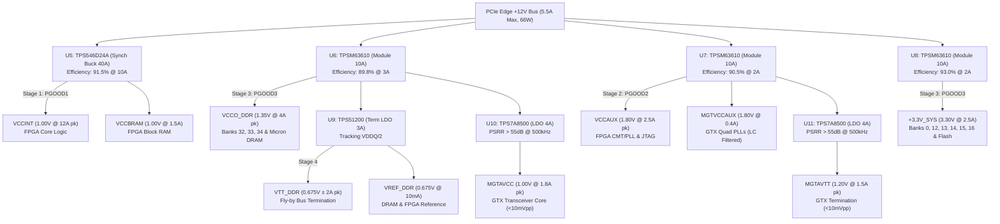

# COMPLETE POWER TREE SPECIFICATION
## Project: ORION-X R1.0
## Classification: High-Density FPGA Computing & PCIe Accelerator PCB
## Document ID: ARCH-PWR-001

---

### 1. POWER TREE SOURCING & CONVERSION TOPOLOGY

---

### 2. POWER TREE PARAMETRIC SUMMARY TABLE

| Rail Name | Input Rail | Regulator IC | Topology | Nominal Voltage | Tolerance | Max Current | Output Power | Ripple Target |
| :--- | :--- | :--- | :--- | :--- | :--- | :--- | :--- | :--- |
| **+12V_PCIE** | Host Slot | Edge Connector | Direct | 12.0 V | $\pm 8\%$ | 3.5 A (typ) | 42.0 W | $\pm 100\text{ mV}$ |
| **VCCINT** | +12V_PCIE | `U5: TPS546D24A` | Buck (PMBus) | 1.00 V | $\pm 3\%$ | 12.0 A (pk) | 12.0 W | $< 10\text{ mV}_{\text{p-p}}$ |
| **VCCBRAM** | +12V_PCIE | `U5: TPS546D24A` | Buck | 1.00 V | $\pm 3\%$ | 1.5 A | 1.5 W | $< 10\text{ mV}_{\text{p-p}}$ |
| **VCCO_DDR** | +12V_PCIE | `U6: TPSM63610` | Buck Module | 1.35 V | $\pm 5\%$ | 4.0 A (pk) | 5.4 W | $< 15\text{ mV}_{\text{p-p}}$ |
| **VCCAUX** | +12V_PCIE | `U7: TPSM63610` | Buck Module | 1.80 V | $\pm 5\%$ | 2.5 A (pk) | 4.5 W | $< 15\text{ mV}_{\text{p-p}}$ |
| **+3.3V_SYS** | +12V_PCIE | `U8: TPSM63610` | Buck Module | 3.30 V | $\pm 5\%$ | 2.5 A (pk) | 8.25 W | $< 25\text{ mV}_{\text{p-p}}$ |
| **VTT_DDR** | VCCO_DDR | `U9: TPS51200` | Sink/Source LDO | 0.675 V | $\pm 3\%$ | $\pm 2.0\text{ A}$ | 1.35 W | $< 10\text{ mV}_{\text{p-p}}$ |
| **MGTAVCC** | VCCO_DDR | `U10: TPS7A8500` | Ultra-Low Noise | 1.00 V | $\pm 3\%$ | 1.8 A | 1.8 W | $< 10\text{ mV}_{\text{p-p}}$ |
| **MGTAVTT** | VCCAUX | `U11: TPS7A8500` | Ultra-Low Noise | 1.20 V | $\pm 3\%$ | 1.5 A | 1.8 W | $< 10\text{ mV}_{\text{p-p}}$ |
| **MGTVCCAUX**| VCCAUX | LC Filter Island | Passive Filter | 1.80 V | $\pm 5\%$ | 0.4 A | 0.72 W | $< 5\text{ mV}_{\text{p-p}}$ |

