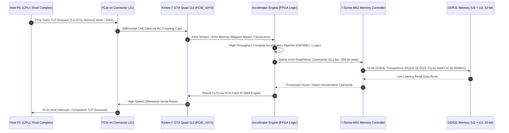

# SYSTEM SIGNAL FLOW & BUS ARCHITECTURE
## Project: ORION-X R1.0
## Classification: High-Density FPGA Computing & PCIe Accelerator PCB
## Document ID: ARCH-SIG-001

---

### 1. HIGH-SPEED COMPUTING PIPELINE DATAFLOW

---

### 2. CONFIGURATION & BOOT SIGNAL FLOW

1. **Power Stabilization**: All power rails ramp via the hardware PGOOD ladder.
2. **Reset Release**: Once `+3.3V_SYS` stabilizes, `PROGRAM_B_0` is pulled high by a $4.7\text{ k}\Omega$ resistor.
3. **Mode Sampling**: Mode pins `M[2:0]` are sampled by Bank 0 logic. Configured to `001` (Master SPI x4 mode).
4. **Flash Initialization**: The FPGA internal configuration master drives `CCLK` (initially at ~3 MHz) and asserts `FCS_B` low to `U4 (Macronix MX25L25645G)`.
5. **Bitstream Ingestion**: Fast Read Quad Output opcode (`0x6B` or `0xEB`) is issued, streaming bitstream data across `D[3:0]` into FPGA Bank 14 at up to 66 MHz.
6. **Done Transition**: Once bitstream CRC is validated, FPGA releases `DONE_0` (open-drain, pulled high to 3.3V via $330\ \Omega$ + Green LED).
7. **PCIe Link Training**: Integrated PCIe block enters LTSSM Detect state, detects host receiver termination, and transitions through Polling to L0 state at Gen1 (2.5 GT/s), auto-negotiating to Gen2 (5.0 GT/s).
8. **MIG Calibration**: DDR3 controller performs write leveling, read DQS centering, and multi-rank calibration against DRAM devices `U2` and `U3`. `CALIB_DONE` LED illuminates green. Accelerator card is fully online.

